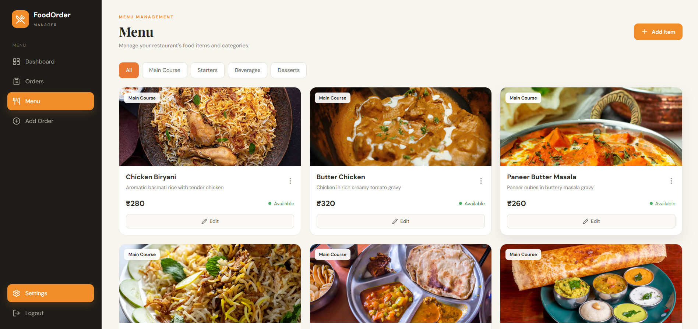

# 🍔 FoodOrderManager

### 📦 Simple. Organized. Efficient Food Order Management.

FoodOrderManager is a full-stack web application designed to help restaurant staff efficiently manage food orders, menu items, and order statuses through a clean and user-friendly dashboard.

The application connects a React frontend with a Node.js and Express.js backend, using MySQL for storing and managing order data.

---

## 📸 Project Preview

<p align="center">
  
</p>

---

## ✨ Features

- 📊 Dashboard with order statistics
- 🧾 View and manage food orders
- ⏳ Track pending orders
- 👨‍🍳 Monitor preparing orders
- ✅ Track completed orders
- 🍔 Manage menu items
- ➕ Add new orders
- ✏️ Update order details
- 🗑️ Delete orders
- 🔍 Search and filter orders
- 🔗 REST API integration
- 🗄️ MySQL database connectivity
- ⚡ Responsive and user-friendly interface

---

## 🛠️ Tech Stack

| Technology | Purpose |
|------------|---------|
| ⚛️ React.js | Frontend |
| 🟢 Node.js | Backend Runtime |
| 🚂 Express.js | REST API |
| 🐬 MySQL | Database |
| 🖥️ XAMPP | Local Database Server |
| 📮 Postman | API Testing |
| 📝 VS Code | Development |
| 🌐 Git & GitHub | Version Control |

---

## 🏗️ Application Flow

```text
        👨‍💼 Staff
           │
           ▼
    ⚛️ React Frontend
           │
           │ API Requests
           ▼
     🚂 Express.js
           │
           ▼
       🟢 Node.js
           │
           ▼
       🐬 MySQL
           │
           ▼
      🍔 Order Data
